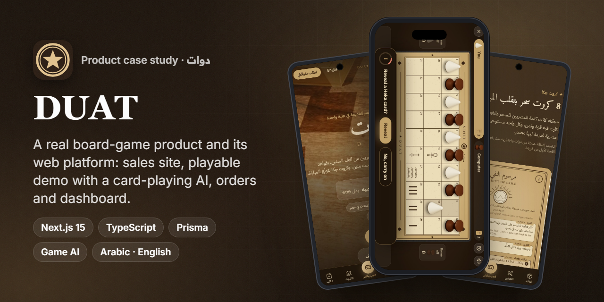
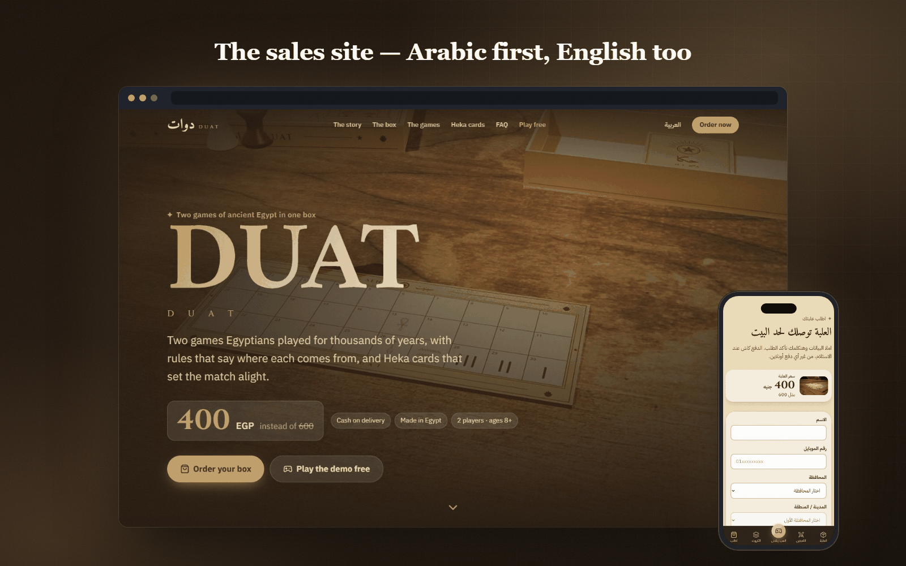
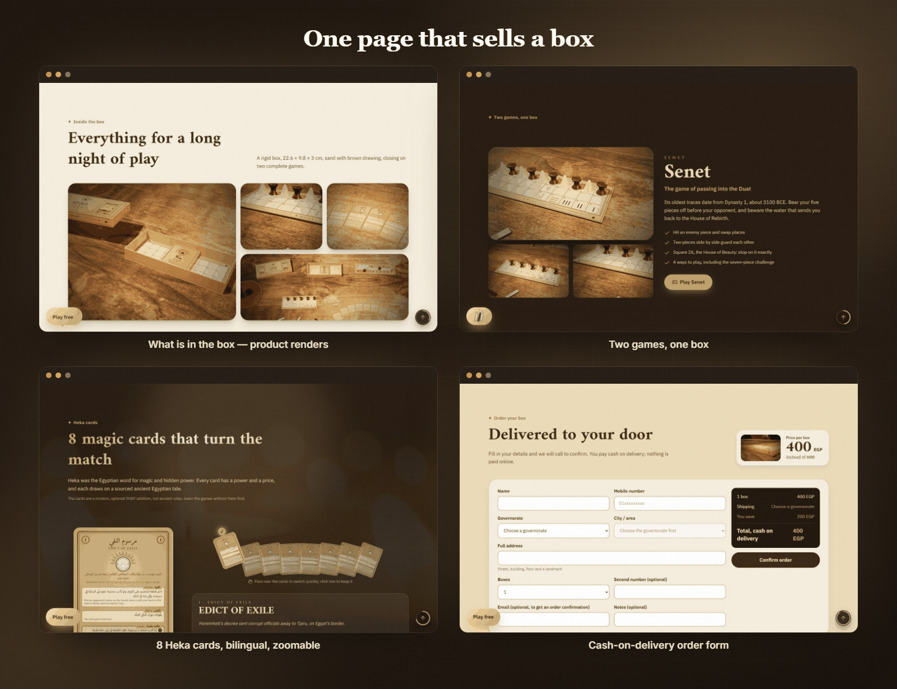
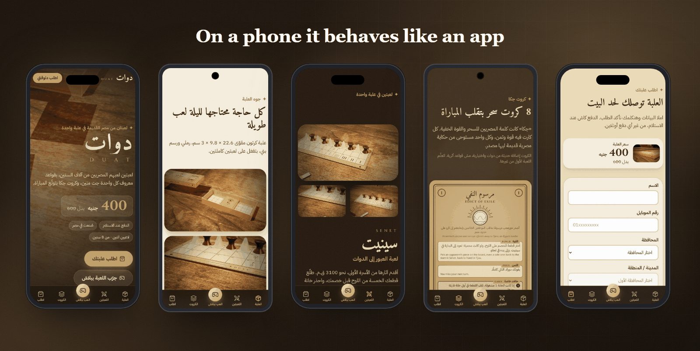
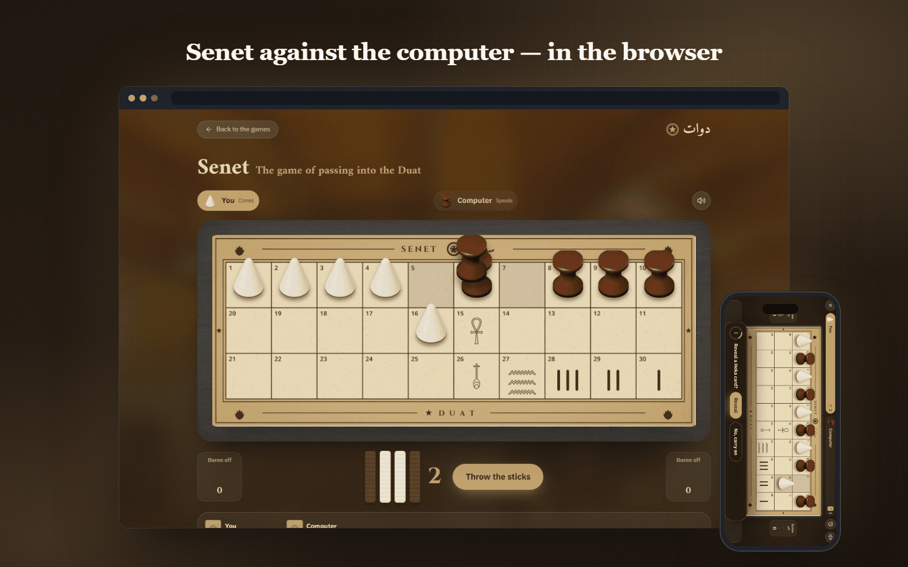
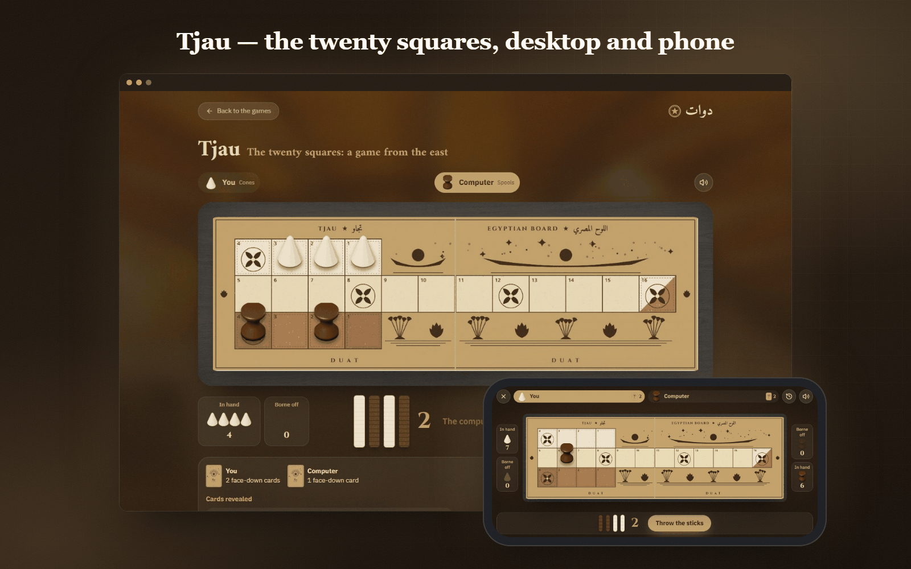
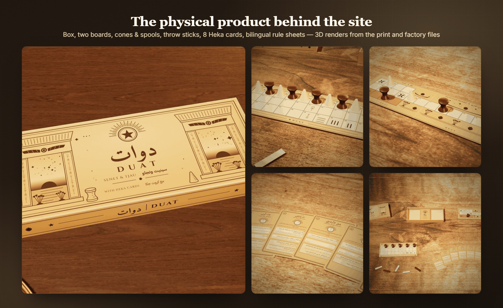
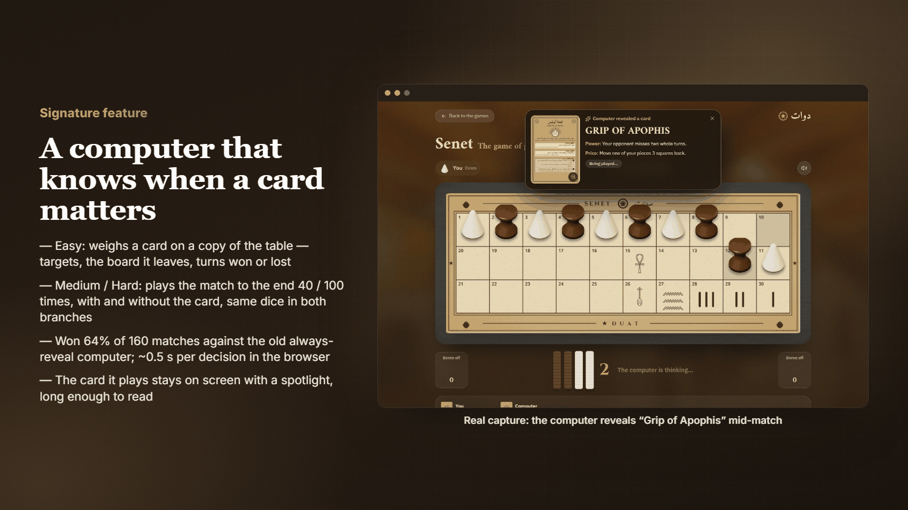
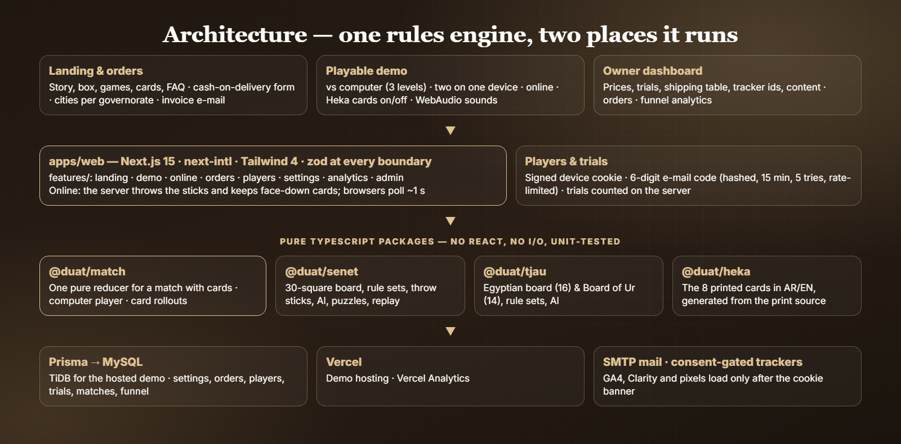
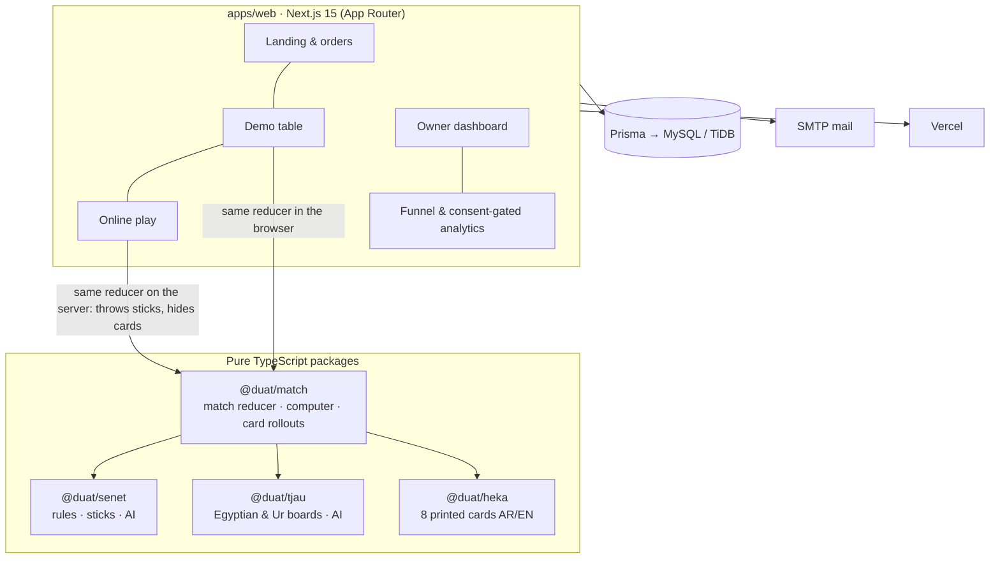

<h1 align="center">DUAT — دوات</h1>

<b>Two board games of ancient Egypt in one box, and a website where you can play them before you buy.</b>

  
  
  
  
  
  
  
  

> ℹ️ Case study. DUAT is my own commercial product, and its source code is private, so it is not included here. Every screenshot below is a real capture of the running app.

## Overview

**DUAT (دوات)** is a physical board-game box sold in Egypt. It holds **Senet**, which Egyptians played from the First Dynasty, and **Tjau**, the "twenty squares", plus **8 Heka cards**: a modern, optional twist that can change a match. Its web platform has three jobs:

1. **Sell the box.** An Arabic-first landing page (English too) that tells the story and shows what is in the box. The order form is cash on delivery.
2. **Let people play first.** A free demo of both games against the computer (3 levels), with two people on one device, or online with a friend. It uses the same boards, pieces and cards as the printed set.
3. **Run the business.** An owner dashboard for prices, trial limits, the shipping table, analytics IDs, content, orders and a sales funnel.

**My role:** founder and the only engineer. I made the product decisions, built the full-stack web platform (rules engines, game AI, online play, orders, dashboard), and produced the print and factory files the physical set is made from.
**Timeline:** autumn 2026. Every decision is written down in a decision log before it is built.

## The challenge

- **Few people know these games.** Almost nobody in the target market has played Senet or Tjau, so the site has to *teach and convince* before it can sell. That is why there is a playable demo, not just photos.
- **The rules are a reconstruction.** Ancient rules survive only in part, so each rule set needed a clear, testable reading. The 8 printed cards also needed one exact meaning on screen.
- **Making a card-playing computer.** Playing a card at the wrong moment wastes it, so a computer that plays them at random feels dumb. It has to know *when* a card matters.
- **Online play must be fair.** Hidden cards and dice throws must not be visible to, or changeable by, the browser.
- **Most visitors are on phones.** On a phone the long boards have to fit like a game app, and the order form has to stay usable while the keyboard is open.
- **Honest marketing.** No AI-generated people and no invented product shots. Every picture is either a render made from the real print files or a licensed stock photo.

## Highlights

**🎲 Games & AI**
- Senet with 4 rule sets (basic, seven-piece Old Kingdom challenge, sixth throw, full challenge)
- Tjau on the Egyptian board (16-square route) and the Board of Ur (14), with Babylon-tablet and extra-throw variants
- Computer opponent at 3 levels. Medium and Hard decide on cards by running full-match **rollouts** (see below)
- Heka cards: none, one or two per player, applied exactly as printed

**🌐 Play modes**
- Against the computer, two players on one device, or **online** by invite link (shared on WhatsApp) or a random opponent, with a fallback to the computer after 30 s
- Free trials per device (signed cookie, counted on the server). More trials unlock after a 6-digit e-mail code

**🛒 Commerce**
- Cash-on-delivery orders: shipping fee per governorate, a city list for each governorate, prices copied onto the order when it is placed
- Order alert and customer invoice e-mails, designed in the DUAT look and readable on a phone
- Bulk orders through WhatsApp, with the number editable in the dashboard

**📊 Owner dashboard & measurement**
- Prices, trial limits, shipping table, content and tracker IDs can all be edited without a deploy
- GA4, Clarity and ad pixels load **only after cookie consent**. The site also counts its own funnel: visits → demo starts → form opens → orders

**📱 Mobile-first**
- On phones the game table is a full-screen **landscape** screen whichever way the phone is held. On the landing page an app-style tab bar replaces the floating buttons

## Screens

<i>The landing page (English, desktop) and the order form (Arabic, phone). The hero background is a 3D film of the real product.</i>

<i>What's in the box, the two games, the 8 Heka cards (hover to preview, click to keep, open full screen) and the cash-on-delivery form.</i>

<i>On a phone, RTL Arabic with an app-style tab bar that highlights the section being read and hides while you type.</i>

<i>Senet against the computer. On an upright phone (right) the whole table is turned a quarter by CSS, so it plays like a landscape game.</i>

<i>Tjau, the twenty squares: pieces in hand, borne off, throw sticks, and the cards each side holds.</i>

<i>The physical set, rendered in 3D from the same print and factory files used to make it. These are renders, not photos.</i>

## Signature feature

**A computer that knows when a card matters.** Each Heka card has a *power* and a *price*. One example is *Grip of Apophis*: your opponent misses two whole turns, but one of your pieces moves 3 squares back. The first version revealed its cards on the first turn, when they did nothing. Now it works like this:

- **Easy** tries the card on a *copy of the table*. It scores the best targets, the board the card leaves behind, and the turns it gains or costs (one turn ≈ 3 squares). It is patient in the opening.
- **Medium and Hard** play the match **to the end 40 / 100 times**, once revealing or playing the card and once not. Both branches get **the same dice**, so any difference comes from that decision alone. The computer picks the branch that wins more often.
- Against the old always-reveal computer, playing the same moves, it **won 64% of 160 matches**. Each decision takes about **half a second in the browser**.
- At the table, the computer holds a revealed card for 5 seconds, and a spotlight shows its power, price and result. The question to the player "reveal a card?" counts down from 10 seconds and then the game carries on. Any card can be opened full size.

## Architecture & stack

| Layer | Tech |
|---|---|
| Monorepo | pnpm workspaces · 4 engine packages + 1 app · shared ESLint / TS / Prettier config package |
| Web app | Next.js 15 (App Router, server actions) · React 19 · Tailwind CSS 4 · next-intl (Arabic first, English) |
| Validation | zod at every boundary (forms, settings, env, API) |
| Game engines | `@duat/senet`, `@duat/tjau`, `@duat/heka`, `@duat/match`: pure TypeScript, no React, no I/O |
| Data | Prisma on MySQL (TiDB for the hosted demo): settings, governorates, orders and order events, players, devices, e-mail codes, trial use, matches, funnel events |
| Mail | Nodemailer over SMTP (order alert, invoice, sign-in code) |
| Analytics | GA4, Microsoft Clarity, Search Console, Vercel Analytics, ad pixels, all loaded after consent |
| Visuals | three.js renders of the printed artwork, lit with a CC0 light probe · WebAudio sound effects (no audio files) |
| Quality | Vitest (222 tests, 18 files) · ESLint with size and complexity limits · `tsc --noEmit` · Prettier |

## Engineering notes

1. **One reducer, two runtimes.** A whole match, including both games and all 8 cards, is a single pure `reduce(state, action)` in `@duat/match`. The browser runs it for games against the computer and on one device. The server runs the same code for online games: it throws the sticks and keeps the face-down cards, and each browser only learns *how many* cards a seat holds. Fair play comes from the design, not from trusting the client.
2. **Printed cards as the single source of truth.** The 8 Heka cards (names, story, power, price, special cases, AR/EN) are generated from the print source. The box and the screen always say the same thing. Where a screen needs one exact answer (swaps in Tjau's shared lane, *Crown of Ahmose* swapping armies, "back to start" landing rules), the reading is recorded as a decision and covered by tests.
3. **Rollouts with common random numbers.** To decide on a card, the computer simulates many playouts with and without the card, using the same dice sequence in each pair. This cuts the noise enough that 40–100 playouts give a stable decision in about 0.5 s on the main thread.
4. **The phone table as a "landscape screen".** Browsers can't lock orientation reliably (iPhone doesn't support it, Android only in full screen). So on an upright phone the whole table is rotated a quarter turn with CSS (`table-screen.css`). The board's size follows the screen height, and zoomed cards open *inside* the rotated screen so they turn with it. It was checked at 320, 360, 390, 667×375, 844×390, 768, 1024 and 1440 px in both languages, with no sideways overflow.
5. **Trials without accounts.** A visitor gets a random device ID in a signed cookie, and trials are counted on the server. An e-mail sign-in unlocks more: codes are hashed, expire in 15 minutes, allow 5 attempts and are rate-limited. All the limits are settings in the dashboard.
6. **Settings, not deploys.** Prices, trial counts, the shipping table, the WhatsApp number and tracker IDs live in a validated settings store. The owner changes them in the dashboard, and the site reads them on the next request.

## Results

Facts from the code and the running app:

- **2 complete games** (Senet with 4 rule sets; Tjau on 2 boards with variants) and **8 Heka cards**, playable against a 3-level computer, on one device or online
- **222 automated tests** in 18 files (Tjau 112, Match 45, Senet 31, Web 31, Heka 3), all passing
- **Fully bilingual** Arabic (RTL) and English across the site, the demo and the e-mails
- A complete **physical product**: box, two boards, pieces, throw sticks, cards and three bilingual rule sheets, with print-ready and factory files
- Live public demo (link below)

## بالعربي

**دوات** منتج مصري: علبة فيها لعبتين من مصر القديمة، **سينيت** و**تجاو**، ومعاهم ٨ **كروت حِكا** بتقلب المباراة. عملت للمنتج منصة ويب كاملة: صفحة بيع عربي وإنجليزي بالدفع عند الاستلام، وديمو تقدر تلعب فيه اللعبتين ضد الكمبيوتر أو مع صاحبك على نفس الجهاز أو أونلاين، ولوحة تحكم لصاحب المشروع.
أهم جزء هو **ذكاء الكمبيوتر في الكروت**: في المستوى المتوسط والصعب بيلعب المباراة لآخرها ٤٠ أو ١٠٠ مرة، مرة بالكارت ومرة من غيره وبنفس رميات العصي في المرتين، وبعدين يختار الطريق اللي بيكسب أكتر.
محرّك القواعد نفسه شغال في المتصفح وعلى السيرفر في اللعب الأونلاين، ومغطّى بـ ٢٢٢ اختبار. وعلى الموبايل الترابيزة بتبقى شاشة عرضية زي ألعاب الموبايل.
أنا صاحب المنتج والمطوّر الوحيد ليه، من ملفات المطبعة والمصنع لحد الكود.

## Links

- 🎮 Live demo: [duat-egypt.vercel.app](https://duat-egypt.vercel.app)

## Credits

The renders of the DUAT set and all the game art are original. The live site also uses licensed stock photos and clips that do **not** show DUAT, mainly as softened section backgrounds (some are visible in the screenshots above):

- *Khan el-Khalili lantern shops at night*: Daniel Nussbaum, [Wikimedia Commons](https://commons.wikimedia.org/wiki/File:Oriental_Lamps_-_panoramio.jpg), CC BY-SA 3.0 (bulk-order strip on the site)
- *Caffè Fishawi, Cairo*: Francesco Gasparetti, [Wikimedia Commons](https://commons.wikimedia.org/wiki/File:Flickr_-_Gaspa_-_Cairo,_Caff%C3%A8_Fishawi.jpg), CC BY 2.0 (story section on the site)
- Wood backplates and café footage: [Unsplash](https://unsplash.com/license), [Pexels](https://www.pexels.com/license/) and [Mixkit](https://mixkit.co/license/) free licences. Lighting: CC0 light probe from [Poly Haven](https://polyhaven.com).

---
<h3 align="center">Built by Mahmoud Shaker — Senior Flutter Engineer</h3>

  
  
  
  
  
  
  

